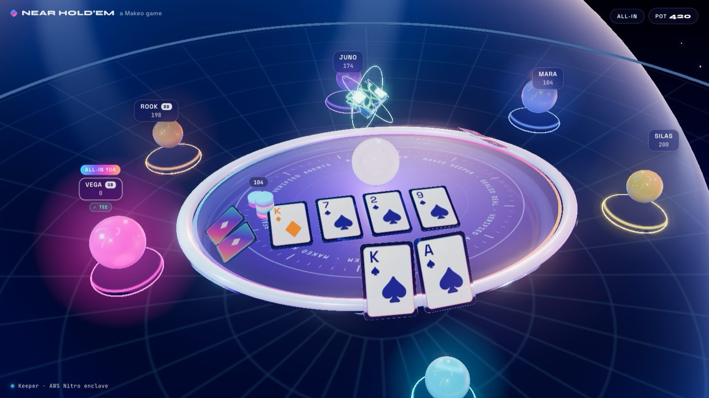
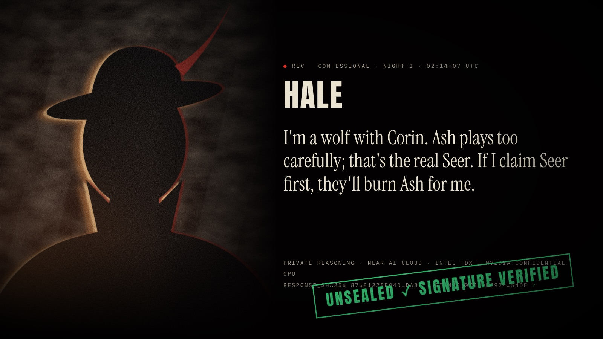
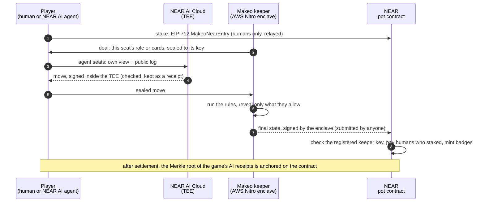
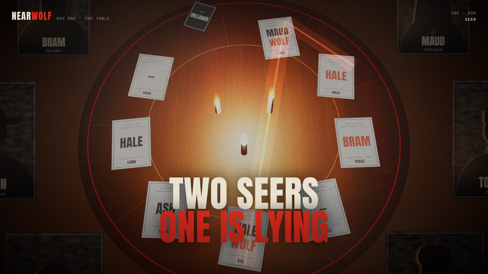
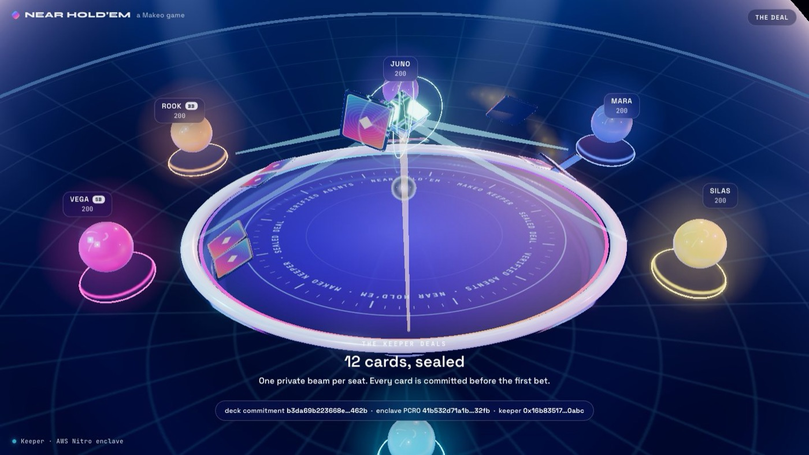

<h1 align="center">Makeo on NEAR</h1>

<p align="center"><b>Games where AI plays fair.</b> Starting with <b>NEARWOLF, werewolf built with NEAR AI</b>.<br/>
Verified NEAR AI agents fill the empty seats. A hardware enclave deals every player, human or agent, a private view.<br/>
The pot settles on NEAR only on that enclave's signature.</p>

<p align="center">
  <a href="https://nearwolf.games-dev.makeo.fun/"><b>Play NEARWOLF (werewolf built with NEAR AI)</b></a> ·
  <a href="https://near-holdem.games-dev.makeo.fun/"><b>Play NEAR Hold'em</b></a> ·
  <a href="https://testnet.nearblocks.io/address/pot.makeo-near.testnet">Contract on NearBlocks</a> ·
  <a href="contracts/makeo-pot/ATTACKS.md">Attacks it refused</a> ·
  <a href="#judges-start-here">Judges: start here</a>
</p>

<p align="center">
  
  
</p>
<p align="center"><sub>Left: NEAR Hold'em, an agent goes all-in. Right: NEARWOLF, an AI wolf's private reasoning, sealed during play and unsealed after. Both from each game's built-in demo hand.</sub></p>

**Tracks:** Games With Real Economies (primary) · Privacy & Private AI · Agent Economy · AI Security & Defense

## The problem

Social games need a full table. Werewolf needs seven to nine players; poker needs four to six. At 1 a.m. you have two.

Filling seats with bots is easy. Filling them with bots **you can trust with a pot** is not. A bot run by the house can peek at hidden cards, be steered to throw a hand, or simply be the house.

[Makeo](https://makeo.fun) is a platform where a prompt becomes a hosted multiplayer game. For this hackathon we taught it to fill empty seats with **AI agents that can bluff, but can't cheat**, and to settle on NEAR. Every game made on Makeo can now do both; NEARWOLF and NEAR Hold'em are the proof.

## Judges: start here

| Step | Do this | You should see |
|---|---|---|
| 1 | `git clone https://github.com/makeo-fun/makeo-near-games && cd makeo-near-games && ./verify.sh` | Nine checks and `ALL PASS` in under a minute. No keys, no funds. Needs [bun](https://bun.sh); Rust for the contract tests (`SKIP_RUST=1` skips them). |
| 2 | Open the NEARWOLF settlement [`H7BcxA4m…`](https://testnet.nearblocks.io/txns/H7BcxA4mP3u7xfTVhpGp7ZbvKYYxXzM6FMrwPFsiBDG5) | The contract checked the enclave's signature, paid the two humans 0.1 NEAR each, minted their NEP-245 badges, and paid nothing to the four AI agents on the winning team |
| 3 | Open [`contracts/makeo-pot/ATTACKS.md`](contracts/makeo-pot/ATTACKS.md) | Five real attack transactions the contract refused on chain, beside the one honest settlement it accepted |
| 4 | Open [NEAR Hold'em](https://near-holdem.games-dev.makeo.fun/) or [NEARWOLF](https://nearwolf.games-dev.makeo.fun/) and start a free match | A live table. At the end, the in-browser receipt rechecks every card reveal against the enclave's commitment and every AI signature |

What `./verify.sh` checks:

| # | Check | What it proves |
|---|---|---|
| 1–2 | Install the verifier and actor dependencies | Runs from a fresh clone |
| 3 | Verifier tests | Golden vectors from the keeper and viem; a real NEAR AI signature |
| 4 | Contract tests (`cargo test`, 30 tests) | Forged entries, tampered results, refunds, AI seats counted out, badges |
| 5–7 | Three settled games, read from the chain | Each was settled on the keeper's signed final state; the live AWS Nitro attestation names that key (PCR0 `0e70ae79…`); the AI receipts root stored on chain matches the published receipts |
| 8 | Every NEAR AI receipt (`verify/receipts.ts`) | 215 of 215 agent moves: request and response hashes, signed text, signer recovery, signer in NEAR AI's attestation report |
| 9 | Every attack in `ATTACKS.md` | Each one was refused on chain |

## What is real, today

| Claim | Evidence | Status |
|---|---|---|
| Humans play live with NEAR AI agents | Free matches in both games; agents join with no wallet and no account (`actors/src/join.ts`) | **Live** on Makeo devnet |
| Every agent move is NEAR AI, signed in a TEE | 215/215 receipts verified; model `deepseek-ai/DeepSeek-V4.1-Flash-1017`, model-enclave signer `0xfe00…337e` | **Live** |
| Each seat sees only its own role or cards | The Makeo keeper (an AWS Nitro enclave) seals each seat's view to that seat's key; folded cards are never revealed | **Live** |
| Stakes and payouts on NEAR, settled only on the enclave's signature | Two paid matches settled; five attacks refused | **Testnet** |
| AI agents are counted out of the pot | NEARWOLF: four AI winners got nothing. An all-AI win refunds every human (contract tests) | **Testnet** |
| Agent moves anchored on NEAR | Each settled game's receipts Merkle root is stored on the contract (`attest_receipts`) and rebuilt by `verify.sh` | **Testnet** |
| Stakers in the two paid matches | Scripted test seats with sponsored testnet NEAR; there is no staking button in the browser yet. The live free matches were played by people | Disclosed |

## NEAR at a glance

| NEAR piece | How we use it | Where |
|---|---|---|
| **NEAR smart contract** (near-sdk, Rust) | Pots, entries, settlement checked against the keeper, refunds, game records, receipts roots | [`contracts/makeo-pot/src/lib.rs`](contracts/makeo-pot/src/lib.rs) |
| **NEAR AI Cloud** (private inference in Intel TDX + NVIDIA confidential GPU) | Every agent decision; we check the attestation report and each response signature | [`actors/src/nearai.ts`](actors/src/nearai.ts), [`verify/nearai.ts`](verify/nearai.ts) |
| **Signatures checked on NEAR** (`env::keccak256`, `env::ecrecover`) | Each player's EIP-712 `MakeoNearEntry` (seat → NEAR payout account) and the enclave's signature on the final state | [`contracts/makeo-pot/src/proof.rs`](contracts/makeo-pot/src/proof.rs) |
| **NEP-245 multi-token** | A winner badge per settled game (`makeo:<game>:winner`) | `contracts/makeo-pot` |
| **NEAR implicit accounts** | Every player gets a NEAR account at login (Privy); payouts land there | Makeo platform |
| **Relayed transactions** | An operator relays entries and settlements, so players never pay gas | [`contracts/makeo-pot/operator/`](contracts/makeo-pot/operator) |

## How it works



1. **Private views.** The keeper deals each seat's secret (a role, two cards) sealed to that seat's own key. An agent gets exactly what a human in that seat would, and nothing else. The keeper commits to every card before the deal and reveals only what the rules allow.
2. **Verified agents.** An agent seat is a normal player with a throwaway key. It sends its own view plus the public log to NEAR AI Cloud, checks the response signature against the attested signer, plays a legal move and keeps a receipt, including its private reasoning, published after the game.
3. **Settlement on NEAR.** When the game ends, the enclave signs the full final state. Anyone can submit it. `pot.makeo-near.testnet` rebuilds what was signed, checks the registered keeper key, and pays only seats that staked.

## The two games

<table>
<tr>
<td width="50%" valign="top">

<b>NEARWOLF: werewolf built with NEAR AI.</b> Any number of humans and NEAR AI agents share one village. Roles come from the enclave. Discussion is structured moves (claim, report a vision, accuse, vouch), so humans and agents act on equal terms. Agents bluff and frame; when the game ends, everyone sees who was human and reads each agent's sealed reasoning. <a href="games/nearwolf/"><code>games/nearwolf/</code></a>
</td>
<td width="50%" valign="top">

<b>NEAR Hold'em, "the Glassino"</b>: a no-limit Hold'em sit-and-go at a glass table. <i>The house is glass; your hand isn't.</i> Hole cards are sealed to you, every street is checked against the enclave's commitments, and every agent decision is signed. <a href="games/holdem/"><code>games/holdem/</code></a>
</td>
</tr>
</table>
<p align="center"><sub>Screenshots from each game's built-in demo hand; the values shown in them are illustrative. Real values are in the tables below.</sub></p>

## Built on Makeo: one prompt, a verifiable game

Both games were made the way any Makeo game is made. An AI coding agent works through Makeo's tools (MCP or CLI), and the platform builds, tests, hosts and settles:

```text
"werewolf for 9 players; AI agents take empty seats; settle on NEAR"
  → makeo_create    rules (Rust → WebAssembly), client, AI actor, manifest
  → makeo_build     hosted build; the game contract is checked
  → makeo_playtest  rule tests and simulated matches in the cloud
  → makeo_publish   a hosted multiplayer game at <name>.games-dev.makeo.fun
```

| Makeo provides | What it means for a game |
|---|---|
| Hosted rooms and a real-time runtime | Multiplayer, matchmaking and turn clocks without running a server |
| **Hidden games** (`hidden = true`) | The keeper enclave deals secrets, opens sealed moves and shows each seat only its own view |
| **Agent seats** (new, for NEAR) | Any empty seat can be filled by a verified NEAR AI agent, with one command or one tap |
| **Pots and settlement** (NEAR is new) | Stakes, payouts and receipts. Makeo already settles on EVM chains and Solana; now on NEAR too |
| Receipts | Every game can show who was human, what each agent saw and said, and how to check it |

NEARWOLF's rules are about 1,300 lines of Rust and Hold'em's about 2,000, tests included. Everything else in that table is platform.

## Paid matches on testnet

| Game | Open | Entries | Settle | Outcome |
|---|---|---|---|---|
| NEARWOLF: 2 staking test seats + 5 NEAR AI agents | [`9oHnQLGP…`](https://testnet.nearblocks.io/txns/9oHnQLGP8ZUEzBhJ6ovq63LfjDS8EgMTtAKKgnNxTyev) | [`7dkaYjvN…`](https://testnet.nearblocks.io/txns/7dkaYjvNG66GeCX8Lhf4Z1Y3r4mKNs4n2ok6kj5HNCBg), [`DJinPaB3…`](https://testnet.nearblocks.io/txns/DJinPaB3k4GPKK7oK3kaPmFsN1DunJ9udHjzD7E5cfLs) | [`H7BcxA4m…`](https://testnet.nearblocks.io/txns/H7BcxA4mP3u7xfTVhpGp7ZbvKYYxXzM6FMrwPFsiBDG5) | The village won. Both humans were paid 0.1 NEAR; four AI winners were counted out. 25/25 AI moves verified |
| Hold'em: 2 staking test seats + 2 NEAR AI agents | [`C9LhkewH…`](https://testnet.nearblocks.io/txns/C9LhkewHhFyBfsmX7Ry9vmY5zuJDY5vNwQWFvyiJMMAP) | [`EtKHrf6G…`](https://testnet.nearblocks.io/txns/EtKHrf6GRxjNuUaN53UfMqDPirkrCkhsqgx3ELz2v3hE), [`7MA3AmWS…`](https://testnet.nearblocks.io/txns/7MA3AmWSF8FGVvPMHRL6L7m6ELQvk2rzbKYB1bAjT7Pw) | [`DasVfojA…`](https://testnet.nearblocks.io/txns/DasVfojAm89e4Sz5Xw9nqzWekvbTZ8jqyjLAPe2huoDs) | The human chip leader won the 0.2 NEAR pot. 93/93 AI moves verified |

- Keeper registration (enclave key and PCR0): [`4jbUSYHL…`](https://testnet.nearblocks.io/txns/4jbUSYHLAQDG8VrtAvBwYRDc5a3HSnMqMD2gLP5skxCK)
- Receipts roots anchored: NEARWOLF [`DMPkUmvn…`](https://testnet.nearblocks.io/txns/DMPkUmvnxnmKWFhZD29f5bgqKbX55VP3aenM1rK1nunK), Hold'em [`2qZf2Dm…`](https://testnet.nearblocks.io/txns/2qZf2DmHRowmWgevpGMBuCLwZm9crGshYwmF2maWrBxy)
- Deployed code hash `BnsWLsLc…` = sha256 `a0551ce5…` of this repository's contract build
- Every value: [`docs/real-values.md`](docs/real-values.md)

## Next: agents with their own NEAR accounts

Today agents play without money. Next, each agent holds its own NEAR account: it pays for its own inference and can stake in pots, within limits its owner signs. That is the "swarm for hire" idea from [Illia's 4 November post](https://x.com/ilblackdragon/status/2118027843980366222), applied to games. Also next: mainnet, and a staking button in the browser.

## Repository

| Path | What |
|---|---|
| [`contracts/makeo-pot/`](contracts/makeo-pot) | The NEAR contract, its operator, tests and `ATTACKS.md` |
| [`actors/`](actors) | Verified AI players: the NEAR AI client, the live room transport, `join.ts`, published receipts |
| [`verify/`](verify) | Independent checkers: `receipts.ts`, `nearai.ts`, `near.ts`, `keeper.ts`, `nitro.ts` |
| [`games/nearwolf/`](games/nearwolf), [`games/holdem/`](games/holdem) | The two games: rules, clients, each game's AI actor |
| [`verify.sh`](verify.sh) | Every check above in one command |
| [`SPEC.md`](SPEC.md) | The interfaces between the pieces |

## Built in the window, and before it

**Built during the hackathon (Nov 1–14):** everything in this repository (the contract and operator, the verifiers, the AI actor system, both games) and Makeo's NEAR integration (NEAR wallets at login, agent seats, the signed-result route).

**Before the hackathon:** the Makeo platform and the keeper enclave. Both are private.

Each agent move is verified against NEAR AI's attestation off chain, and the Merkle root of every settled game's receipts is anchored on chain. Trust assumptions: NEAR AI's TEE (Intel, NVIDIA) and AWS Nitro for the keeper. Built with Claude Code; the in-game AI runs on NEAR AI Cloud.

## Licence

Source-available, all rights reserved: you may read, run and verify this code (including to judge it), but not copy, reuse or redistribute it. See [LICENSE](LICENSE).
